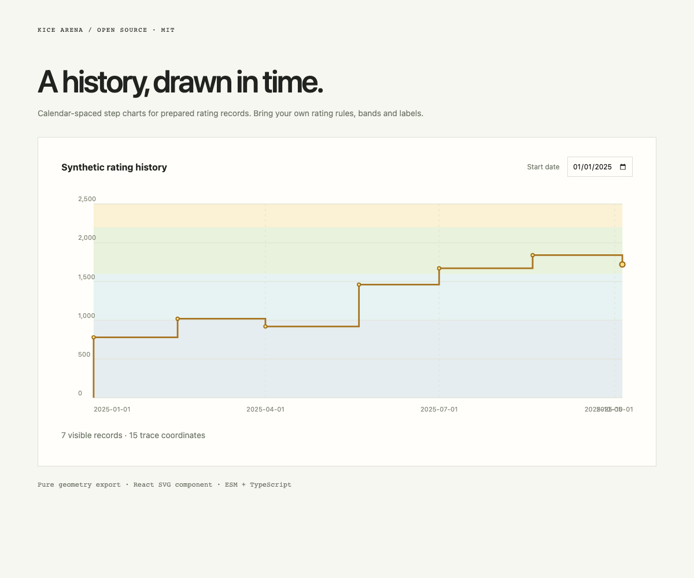

# @kicearena/rating-chart

Calendar-spaced step chart geometry and an accessible React SVG renderer for **already-calculated rating histories**.

[MIT](LICENSE) · ESM + TypeScript · Pure geometry / React 19



## Use

Configure the @kicearena scope for GitHub Packages and provide a read:packages token through `NODE_AUTH_TOKEN` (public GitHub npm packages also require authentication).

```ini
@kicearena:registry=https://npm.pkg.github.com
//npm.pkg.github.com/:_authToken=${NODE_AUTH_TOKEN}
```

```sh
bun add --exact @kicearena/rating-chart@0.1.0
```

```tsx
import { ratingHistoryChart, RatingChartSvg } from "@kicearena/rating-chart";
const history = [{ startedAt: "2025-01-01T00:00:00Z", rating: 1200 }];
const chart = ratingHistoryChart(history, {
  width: 600,
  height: 260,
  minimumStart: "2025-01-01T00:00:00Z",
});
// If chart is non-null:
<RatingChartSvg
  chart={chart!}
  aria-label="Rating history"
  pointTitle={(index) => `Event ${index + 1}`}
  formatTime={(at) => new Date(at).toISOString().slice(0, 10)}
/>;
```

`@kicearena/rating-chart/geometry` has no React runtime import. Input records are chronological `{startedAt, rating}` values. `recordIndex` maps visible points back to the original records. A selected start date carries the preceding rating into the trace; an empty history returns null. Coordinates follow elapsed time rather than array indices. Calendar ticks use KST month boundaries, matching the original Korean display; label formatting remains caller-owned.

Options: `width`, `height`, `minimumStart`, `startAt`, `highestRankBoundary`. The package contains no fixed season launch, rating formula, rank thresholds, account/API access or fetch. `RatingChartSvg` receives prepared `{key,minimum,maximum,color}` bands and label functions; resize observation and date controls stay in the host.

## Showcase and development

```sh
bun install --frozen-lockfile
bun run demo
bun run check
bun run test
bun run build
bun run demo:build
```

The editable showcase uses synthetic records. Tests preserve the original time spacing, zero baseline, selected-period carry, rank-boundary extent and SVG markup. Publish an immutable exact version with a matching `v<version>` tag.

## License

[MIT](LICENSE) © 2026 KICE Arena contributors.
